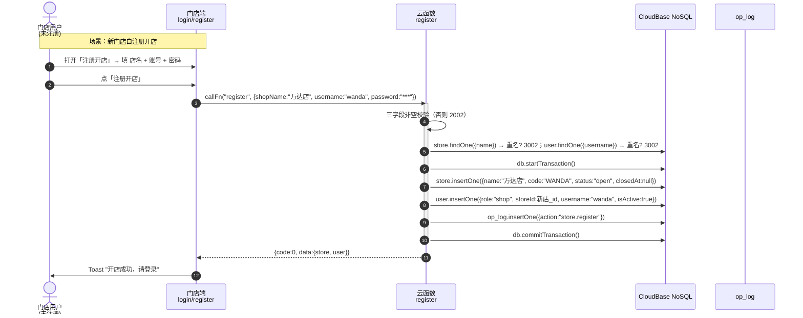
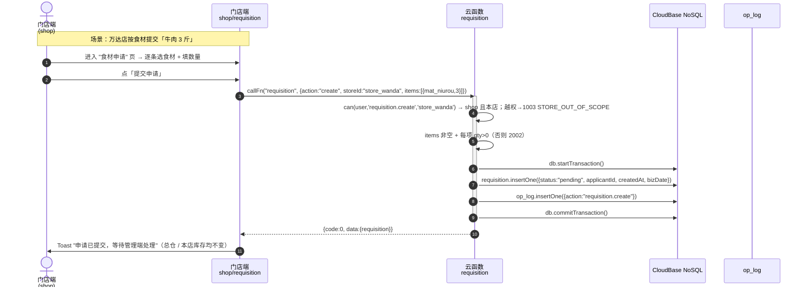
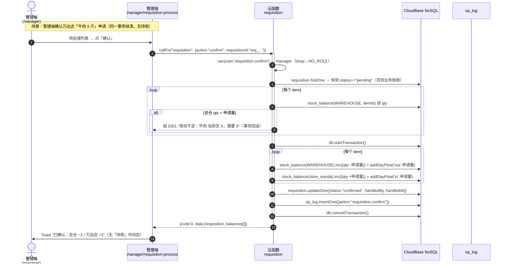
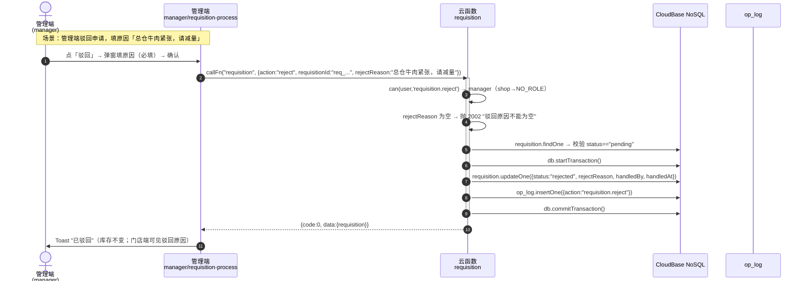
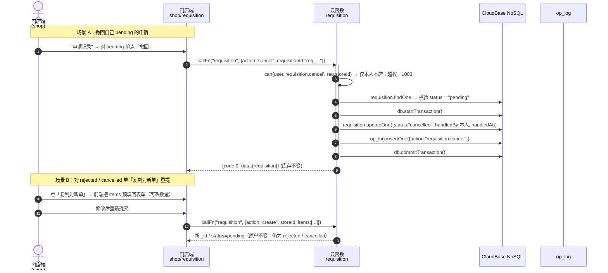

# 王婆婆家常菜 · 仓库与重要食材管理小程序 · 系统架构与任务分解

> **项目根**：`C:\Users\Administrator\WorkBuddy\2026-07-30-09-42-20\wechat-erp-miniprogram\`
> **版本**：v1.5（**角色 4→2 + 模块精简重大修订**，对齐 PRD v0.8）—— 彻底删除 `owner`/`admin`/`storekeeper`/`storeManager` 四分法与「老本红线」整套机制，收敛为**管理端 `manager`（系统预置·唯一·不可新增）** + **门店端 `shop`（门店自注册开店，1 门店 1 账号）**；删除**供应商模块**与**独立配方模块**（改为菜品内嵌消耗食材清单）；食材单位改**自由文本**；权限矩阵由「4 角色 × 20 动作」重写为「**2 角色 × 22 动作**」**（含 v0.8 新增的 `store.toggle` 门店启停）**。
> **范围**：MVP = P0 全量 + P1（账号与角色纳入 MVP，对应 F1-5）。
> **唯一可运行代码**：`wechat-erp-web/`（**纯静态零依赖 WEB 测试版**，本次改造对象）；`wechat-erp-miniprogram/` 为小程序设计文档 + 云函数骨架。
> **权限实现唯一权威**：WEB 版 `js/auth.js#actionToRequiredRoles()` 与本文 **§7.6 权限矩阵速查表**（两者必须逐格一致）。
> **唯一需求权威**：`docs/PRD.md` **v0.8**。本版为**整体重写**（非增量 patch）——不沿用 v1.4 的任何 4 角色产物（4 列矩阵 / 8 类红线 / `supplier` / `recipe` 集合一律作废）。

> ### ⚠️ 本版要点（1 行）
> **2 角色 + 菜品内嵌消耗清单 + 单位自由文本 + 门店自注册 + 申请一步到位 + 门店启停（停用可复业）+ 全库无金额。**

---

## 1. 实现方案总览

## 1. 实现方案总览

### 1.1 总体形态

```
┌──────────────────────────────────────────────────────────────┐
│ 1 · 客户端（一个小程序 / 一个 WEB 单页，按角色差异化首页）      │
│   - 管理端（manager · 系统预置唯一）首页 = 商品管理           │
│       商品管理 / 采购入库 / 申请处理 / 总仓库存+食材预警 /     │
│       分店经营 / 分店与账号                                   │
│   - 门店端（shop · 自注册，1 账号 = 1 门店）首页 = 今日出品    │
│       注册开店 / 今日出品 / 食材申请 / 本店库存 / 剩余实点 /   │
│       申请记录                                                │
│   - 共享：我的（导出、权限自检）                              │
├──────────────────────────────────────────────────────────────┤
│ 2 · 前端框架：微信原生（WXML + WXSS + JS）/ WEB 原生三件套     │
│   - 无第三方框架；WEB 版禁用 ES Module（file:// 双击可跑）     │
│   - utils/cloud.js 封装 wx.cloud.callFunction                 │
│   - utils/auth.js 角色 / 门店上下文；utils/datetime.js 时区    │
├──────────────────────────────────────────────────────────────┤
│ 3 · 后端：微信云函数（Node.js 14+），共 13 个                 │
│   一个云函数 = 一个业务职责，统一返回 { code, data, message }  │
├──────────────────────────────────────────────────────────────┤
│ 4 · 数据：CloudBase NoSQL 9 个集合 + 1 个 op_log 审计 = 10    │
│   - 6 业务主档：store / material / dish / purchase /         │
│     requisition / production / stocktake                     │
│   - 1 余额派生：stock_balance                                 │
│   - 1 用户：user（role 单值）                                 │
│   - 1 审计：op_log（写扩散，不入主业务）                      │
│   - 【已删除】shipment（v1.4 删）/ supplier / recipe          │
└──────────────────────────────────────────────────────────────┘
```

### 1.2 关键架构决策

| # | 决策 | 理由 |
|---|------|------|
| D1 | 客户端只发 RPC，不直连数据库 | 权限、事务、校验统一收敛在云函数；后续接老板 PC 端可复用 |
| D2 | 一个云函数 = 一个业务领域 | 单职责，便于加锁、扩参、独立部署；命名与文档一一对应 |
| D3 | 余额表 `stock_balance` 与流水分离 | 余额 = 期初 + 入 − 出 − 耗 的派生结果，单文档存当前值避免累加误差 |
| D4 | **角色单值嵌入 `user`**（`role: 'manager' \| 'shop'`） | v0.8 取消多角色/兼任；登录一次即拿到身份，前端无 token；`manager` 走总仓域，`shop` 走本店域 |
| D5 | 首日期初 = 0 + 采购/确认产生库存 | 避免冷启动期初缺数 |
| D6 | 业务流必须用 NoSQL 事务 | 采购 / **注册开店** / **申请确认** / 出品 / 实点都跨集合（流水+余额），transaction 保证原子 |
| D7 | `op_log` 写扩散 | 任何写操作落流水时同步追加一条审计；只读场景不写 |
| D8 | 时区统一 `Asia/Shanghai (UTC+8)` | 报表按"营业日"分桶，避免跨日数据归错日；存 ISO + 北京时区字符串 |
| **D9** | **申请确认「一步到位」**（无「待收」中间态） | 同一事务内总仓 −申请量、门店 +申请量，直接终态；无中转库存 |
| **D10** | **单据只经历一次状态流转**（驳回/撤回后「复制为新单」重提） | 审计链清晰；避免"回退后篡改历史数量"；与 `_id` 不可变主键约定一致 |
| **D11** | **全库只记数量、不记金额** | 老板拍板；报表只用「份数 / 用量 / 差异」三个量 |
| **D12** | **消耗清单内嵌菜品**（`dish.consumeItems`） | 取消独立配方模块；`扣减量 = 份数 × 每份用量`，一菜一清单，维护就近 |
| **D13** | **门店端自注册开店**（一事务建 store + user） | v0.8：无审批；管理端**不产生门店/账号**；管理端仅可改店名 / 改密码 / 闭店复业 |
| **D14** | **管理端唯一且不可新增** | 系统预置 1 条 `role='manager'`；界面无创建入口，绕过接口一律 `1003`；库内恒为 1 |

### 1.3 权限架构

- **2 类角色**：`manager`（管理端 · 总仓 · 系统预置唯一 hardcode） / `shop`（门店端 · 分店 · 自注册，1 账号 = 1 门店）。
- **单角色模型**：`user.role` **单值**，无 `roles[]`、无 `stores[]`、无兼任、无账号类型选择。
- **双重拦截原则**：① 前端 UI 按 `effectiveRole ∈ requiredRoles` 隐藏入口（优化体验，非安全）；② 云函数入口 `_shared/auth.js` 强制校验（安全底线）。
- **门店域（`storeScope`）**：门店端申请/撤回/出品/实点/本店库存一律限本店（越权 → `1003 STORE_OUT_OF_SCOPE`）。
- **管理端域**：`manager` 的 `storeId = null`（总仓）；采购/确认/驳回/食材预警/分店经营/导出均落在总仓维度。
- **哨兵动作（`user.manage` / `store.manage`）**：两列**均为 ❌**、界面**无入口**；`actionToRequiredRoles` 返回 `[]`，任何角色调用一律 `1003 NO_ROLE`。保留它们只为：① 显式表达"系统不支持此类操作"；② 让绕过 UI 的调用有明确拒绝出口。
- **已删除机制**：`OWNER_WRITE_FORBIDDEN`（老本红线整套）、账号类型预设（`accountPreset` / `accountTypeOf`）、管理员纯只读角色、多角色多门店。
- **闭店影响**：门店 `status='closed'` 时，其 `shop` 账号登录一律拒绝（`1001`，message 与"密码错误"区分）；已登录会话的写动作一并拒绝（`STORE_CLOSED`）。仅 `manager` 可 `store.toggle` 闭店 / 复业。

---

## 2. 框架选型

| 层 | 选型 | 替代 | 选择理由 |
|----|------|------|----------|
| 客户端 | 微信原生 WXML/WXSS/JS（WEB 版：原生 HTML/CSS/JS） | Taro / uni-app | 主人已确认原生；无构建链；冷启动 < 1s；包体小 |
| 客户端状态 | Page.data + globalData | MobX / Redux | 业务规模 ~12 页，单向数据流够用 |
| 后端 | 微信云函数 Node.js | 云托管 Docker | 云函数免运维、按调用付费、与小程序鉴权一体化 |
| 数据库 | CloudBase NoSQL | MySQL | 文档型天然贴合"流水+嵌套明细"；事务 API 满足 MVP |
| 鉴权 | `wx.cloud.getWXContext().OPENID` | JWT | 零成本，openid 即天然身份 |
| 时间 | Day.js（仅前端格式化） | 原生 Date | 体积小（~7KB），仅前端使用；后端用 Date 对象 |
| UI 样式 | 原生 WXSS + 少量 BEM 命名 | Vant / iView | MVP 控件少（List/Form/Stepper/Toast），原生够用 |
| 存储 | CloudBase 云存储 | 无 | 仅 P2 图片附件需要，MVP 不开 |

> **全库去金额**：`utils/format.js` **只保留 `formatQty(n, unit)`**（单位取自食材 `unit` 自由文本），`formatMoney()` 物理删除；任何页面 / 报表 / 导出 / 看板不得出现金额、单价、成本、毛利（含派生计算）。
> **单位自由文本**：**删除 `UNIT` / `UNIT_LABEL` 枚举**，`formatQty(n, unit)` 的 `unit` 由调用方传入食材的 `material.unit`；**不再有 `UNIT_LABEL[unit] \|\| '斤'` 兜底映射**（单位原样展示，不换算）。

---

## 3. 文件列表及相对路径

> 命名原则：pages 下按 `角色/业务` 分目录；云函数 = 业务动词/名词单数。

### 3.1 客户端 `miniprogram/`

```
miniprogram/
├── app.js                                # onLaunch 拉 login 云函数写 globalData
├── app.json                              # 按角色动态注入 tabBar.list（运行时 setTabBarItem）
├── app.wxss                              # 全局样式 + 设计 token（色/字号/圆角）
├── project.config.json / sitemap.json     # 已有
│
├── utils/
│   ├── cloud.js                          # 已有：callFunction + 统一错误码映射
│   ├── auth.js                           # can(user,action,storeId) / 单角色判定（无 accountPreset/accountTypeOf）
│   ├── datetime.js                       # formatYmdHm / todayStr / isToday / shiftDay
│   ├── format.js                         # formatQty(n, unit)（单位自由文本，无金额）
│   └── constants.js                      # ROLE / ACTION / REQ_STATUS / PROD_STATUS / DIFF_TYPE / STORE_STATUS / CONFIG（无 ACCOUNT_TYPE / OWNER_WRITE_FORBIDDEN / UNIT）
│
├── pages/
│   ├── login/login.{js,wxml,wxss,json}   # 微信一键登录 + 注册开店入口 + 管理端首登强制改密
│   ├── mine/profile/{js,wxml,wxss,json}  # 我的（含导出、权限自检）
│   │
│   ├── manager/                           # 管理端（页面顺序 = 侧边栏顺序）
│   │   ├── goods/{...}                   # ① 商品管理（食材 / 菜品 两页签）· 默认首页
│   │   ├── purchase/{...}                # ② 采购入库（无单价 / 无供应商）
│   │   ├── requisition-process/{...}     # ③ 申请处理（确认 / 驳回）
│   │   ├── wh-stock-alert/{...}          # ④ 总仓库存 + 食材预警（合并页）
│   │   ├── business/{...}                # ⑤ 分店经营（今日 / 近 7 天 / 本月）
│   │   └── shops-accounts/{...}          # ⑥ 分店与账号（查看 + 改店名 + 改密码 + 闭店/复业）
│   │
│   └── shop/                              # 门店端（页面顺序 = 侧边栏顺序）
│       ├── register/{...}                # ① 注册开店（仅未注册时可见）
│       ├── production/{...}              # ② 今日出品 · 登录后默认首页（菜品在前）
│       ├── requisition/{...}             # ③ 食材申请（提交 / 撤回）
│       ├── store-stock/{...}             # ④ 本店库存（只读）
│       ├── stocktake/{...}               # ⑤ 剩余实点
│       └── requisition-history/{...}     # ⑥ 申请记录（含驳回原因 + 复制为新单）
│       └── mine/profile/                 # 共享：我的
```

> **已删除页面**：`storekeeper/*`、`owner/*`、`store/pending-receive`、`store/requisition`（旧）、`recipe/*`、`supplier/*`。
> **管理端无「新建管理端 / 新建账号 / 新建分店 / 删除分店」入口**；分店只能由门店端注册产生。

### 3.2 WEB 测试版 `wechat-erp-web/`（本次实际改造对象）

> **⑥视图文件重排（docs 口径，供工程执行）**：旧 4 角色视图合并为 2 角色视图。

| 旧文件（v1.4） | 新文件（v1.5） | 说明 |
|---|---|---|
| `js/views/owner.js` + `js/views/storekeeper.js` | **`js/views/manager.js`（新）** | 两个旧视图**合并**为管理端 6 页：商品管理 / 采购入库 / 申请处理 / 总仓库存+食材预警 / 分店经营 / 分店与账号 |
| `js/views/manager.js`（旧，门店端 4 页） | **`js/views/shop.js`（改名）** | 门店端 6 页：注册开店 / 今日出品 / 食材申请 / 本店库存 / 剩余实点 / 申请记录 |
| `js/views/login.js` | `js/views/login.js` | **新增**「注册开店」入口；管理端首登强制改密保留 |
| `js/views/profile.js` | `js/views/profile.js` | 导出卡计数去发货/收货，改 `{purchase, requisition, production, stocktake}`；动作列表同步 |
| `js/views/owner.js` / `storekeeper.js` | — | **物理删除**（内容已并入新 `manager.js`） |

```
wechat-erp-web/
├── index.html                 # 单页外壳（脚本加载顺序改为：constants→store→auth→biz→ui→views/login→views/manager→views/shop→views/profile→app）
├── css/app.css                # 全部样式（删「金额 / 单价」相关类，可选）
├── js/
│   ├── constants.js           # 【改】ROLE(MANAGER/SHOP)、ACTION(22)、REQ_STATUS、PROD_STATUS、DIFF_TYPE、STORE_STATUS、CONFIG；
│   │                          #       删 ACCOUNT_TYPE* / ROLE_ORDER / OWNER_WRITE_FORBIDDEN / SHIP_STATUS / UNIT / UNIT_LABEL / fmtMoney
│   ├── store.js               # 【改】SEED_VERSION 5→6、COLLECTIONS（删 supplier/recipe/shipment）、buildSeedEmpty/buildDemoSeed、getBalance/changeBalance
│   ├── auth.js                # 【改】actionToRequiredRoles()（22 动作 × 2 角色）、can()（单角色 + 闭店拦截）；删 accountPreset/accountTypeOf/isWriteAction(红线)
│   ├── biz.js                 # 【改】删 supplier/recipe 业务；purchase 去 supplier/金额；saveDish 改 consumeItems；新增 registerStore/renameStore/resetPassword/toggleStore；
│   │                          #       requisition 五函数（create/confirm/reject/cancel/query）；production 改 ×qtyPerPortion；business/lowStock；exportFlows(12 列)
│   ├── ui.js                  # 【改】删 money()；其余不变
│   ├── app.js                 # 【改】调试提示文案（去发货/收货，加注册开店 / 食材申请）
│   └── views/
│       ├── login.js           # 【改】新增「注册开店」表单入口
│       ├── manager.js         # 【新】管理端 6 页（由旧 owner.js + storekeeper.js 合并重写）
│       ├── shop.js            # 【改名】门店端 6 页（旧 manager.js 内容重写）
│       ├── owner.js           # 【删】并入 manager.js
│       ├── storekeeper.js     # 【删】并入 manager.js
│       └── profile.js         # 【改】导出卡计数 + 动作列表 + 文案
├── tests/verify.js            # 【改】回归断言随改造更新（角色/动作/集合/去金额/注册开店/闭店）
├── README.md                  # 【改】权限矩阵 / 验收清单 / 文件结构 / 去金额 / 2 角色
└── 报价测算.md                # 【改】去金额口径、去供应商/配方、规模数字
```

### 3.3 云函数 `cloudfunctions/`（共 **13** 个）

```
cloudfunctions/
├── _shared/                       # 共享模块（不直接部署；被各函数 require）
│   ├── response.js                # 统一 {code,data,message} 封装 + 错误码枚举
│   ├── auth.js                    # can(user,action,storeId) + 解析 OPENID → ctx.user
│   ├── db.js                       # 集合名常量、_ = db.command、事务包装 withTx
│   └── log.js                      # 写 op_log 工具
│
├── login/                          # openid → 身份（含闭店拦截）
├── register/  [NEW]                # 注册开店：一事务建 store + user（店名/账号唯一）
├── material/                       # 食材档案 CRUD（unit 自由文本；含 lowStockThreshold）
├── dish/                           # 菜品档案 CRUD（含内嵌 consumeItems；无 price）
├── store/                          # 门店：list / rename / toggle(闭店·复业)（无建店·无删除）
├── purchase/                       # 采购入库（事务：写流水 + 加总仓余额；无金额 / 无供应商）
├── requisition/                    # 食材申请：create / confirm / reject / cancel / list / get
├── production/                     # 出品（事务：按 dish.consumeItems 扣减多食材）
├── stocktake/                      # 实点（事务：写差异 + 覆盖余额）
├── inventory/                      # 库存查询/汇总（总仓或本店）
├── report/                         # 分店经营 / 食材预警 / 差异预警 聚合
├── opLog/                          # 审计查询（manage 全部 / shop 自己）
└── export/                         # 数据导出（12 列宽表，一明细一行）

# 【已删除】recipe / supplier / shipment / receive
```

> 集合数：**10 个**（`user` / `store` / `material` / `dish` / `purchase` / `requisition` / `production` / `stocktake` / `stock_balance` / `op_log`）。
> 总计 **9 业务 + 1 审计**；`shipment`（v1.4 删）、`supplier`、`recipe` 均已物理删除。

---

## 4. 数据结构和接口

### 4.1 集合一览（v1.5）

| 集合 | 主键 | 关键字段 | 用途 | 本次变更 |
|------|------|----------|------|----------|
| `user` | `_id` | `openid`(uniq) / `name` / `username` / **`role`(单值)** / **`storeId`(单值·manager 为 null)** / `passwordChanged` / `isActive` / `createdBy` / `createdAt` | 登录身份 | **`roles[]`→`role`；`stores[]`→`storeId`；删账号类型** |
| `store` | `_id` | `code` / `name`(uniq) / **`status`('open'\|'closed')** / **`closedAt`** / `createdAt` | 门店档 | **新增 `status` / `closedAt`（v0.8）**；删 `type` / `isActive`（改由 `status` 表达） |
| `material` | `_id` | `name`(uniq) / **`unit`(自由文本)** / `defaultShelfDays` / `lowStockThreshold` / `isActive` | 食材档 | **`unit` 枚举→自由文本**；`name` 全局唯一 |
| `dish` | `_id` | `name`(uniq) / **`consumeItems:[{itemId, qty}]`** / `isActive` | 菜品档 | **新增内嵌 `consumeItems`；删 `price`；删 `storeId`（菜品全局）** |
| `purchase` | `_id` | `itemId` / `qty` / `operatorId` / `bizDate` / `createdAt` / `remark` | 采购流水（总仓入库） | **删 `storeId`（隐含总仓）、`supplierId`、`unitPrice`/`totalPrice`** |
| `requisition` | `_id` | `storeId` / `applicantId` / `items[{itemId,qty}]` / `status` / `createdAt` / `bizDate` / `handledBy` / `handledAt` / `rejectReason` | 食材申请单 | 不变（沿用 v0.6） |
| `production` | `_id` | `storeId` / `dishId` / `qty` / `consumeItems[]` / `status` / `operatorId` / `bizDate` / `createdAt` | 出品流水 | 扣减公式改 **×每份用量** |
| `stocktake` | `_id` | `storeId` / `itemId` / `actualQty` / `theoryQty`（`bookQty`）/ `diff` / `diffType` / `source` / `operatorId` / `bizDate` / `createdAt` | 实点差异流水 | 不变（去 `receive` 分支） |
| `stock_balance` | `_id` | `storeId` / `itemId` / `qty` / `dayOpenQty` / `dayInQty` / `dayOutQty` / `dayOpenDate` / `updatedAt` | 余额派生 | 总仓维度 `storeId` 用保留键 `WAREHOUSE`（虚拟总仓，非 store 实体） |
| `op_log` | `_id` | `actorId` / `actorName` / `action` / `target` / `before` / `after` / `createdAt` | 审计 | 不变（动作枚举随 §7.6 更新） |
| ~~`recipe`~~ | — | — | 独立配方 | **【物理删除】数据内嵌 `dish.consumeItems`** |
| ~~`supplier`~~ | — | — | 供应商 | **【物理删除】** |
| ~~`shipment`~~ | — | — | 发货流水 | **【物理删除】（v1.4 已删）** |

> **保留键 `WAREHOUSE`**：v0.8 删除了「总仓」门店实体，但总仓余额仍需与门店区分。故 `stock_balance.storeId` 与 `purchase` 隐含维度统一用常量 `C.STORE_WAREHOUSE = 'WAREHOUSE'`（**非 `store` 文档，仅作余额分区键**）。门店维度用真实 `store._id`。

> **索引建议**：`user.openid` 唯一；`user.username` 唯一；`store.name` 唯一；`material.name` 唯一；`dish.name` 唯一；`stock_balance(storeId,itemId)` 唯一；`requisition(storeId,status)`、`requisition(status,createdAt)`、`production(storeId,createdAt)`、`stocktake(storeId,createdAt)` 普通。

#### 4.1.1 `requisition`（食材申请单）· 完整字段表

| 字段 | 类型 | 必填 | 说明 |
|------|------|:---:|------|
| `_id` | string | ✅ | 主键，规则：`req_<YYYYMMDD>_<storeCode>_<6位序号>`，例 `req_20260730_WANDA_000123`（见 §7.2） |
| `storeId` | string | ✅ | 申请门店 `_id`；**必须 = 发起人 `user.storeId`**（越权 → `1003 STORE_OUT_OF_SCOPE`） |
| `applicantId` | string | ✅ | 申请人 `_id`（门店端账号）；落库时由服务端取当前登录用户，不信任前端 |
| `items` | array | ✅ | 食材明细，**≥1 条**：`[{ itemId: string, qty: number }]`；每条 `qty > 0`（否则 `2002`） |
| `status` | enum | ✅ | `pending` \| `confirmed` \| `rejected` \| `cancelled`（见 §4.2 状态机） |
| `createdAt` | iso | ✅ | 申请时间（ISO 8601 +08:00） |
| `bizDate` | string | ✅ | 营业日 `YYYY-MM-DD`（04:00 切分） |
| `handledBy` | string | ⭕ | 处理人 `_id`（确认 / 驳回 / 撤回同字段；`pending` 时为空串）。**字段名以 PRD §6.5 为准** |
| `handledAt` | iso | ⭕ | 处理时间（`pending` 时为空串） |
| `rejectReason` | string | ⭕ | 驳回原因，**仅 `rejected` 有值**（必填，空 → `2002`）；其它状态为空串 |

> `items` 只按**食材（食材 + 数量）**逐条申请，**不做按菜品申请**。
> 一张单据只经历一次状态流转（`pending → confirmed/rejected/cancelled`），驳回 / 撤回后**新建单据**重提，原单不变（D10）。

#### 4.1.2 `material` / `dish` 字段口径（对齐 PRD §6.6）

**`material`**

| 字段 | 必填 | 规则 |
|------|:---:|------|
| `name` | ✅ | **全局唯一**（重名 → `3002`） |
| `unit` | ✅ | **自由输入文本**（斤 / 个 / 份 / 包 / 瓶…）；**不做固定枚举、不做换算** |
| `lowStockThreshold` | ⭕ | 数字；留空 / null / ≤0 → 取全局默认 `CONFIG.LOW_STOCK_THRESHOLD = 2`；仅**总仓维度**参与预警 |
| `isActive` | — | 停用 = 软删除 |

**`dish`**

| 字段 | 必填 | 规则 |
|------|:---:|------|
| `name` | ✅ | **全局唯一**（重名 → `3002`） |
| `consumeItems` | ⭕ 可空 | `[{ itemId, qty }]`；每行 = 一个食材 + **每份用量**；可为空数组 |
| `isActive` | — | 停用 = 软删除 |

> **出品扣减 = 份数 × `consumeItems[].qty`**（牛肉火锅 每份 0.5 斤 × 3 份 = 1.5 斤）。

#### 4.1.3 本次**被删除 / 新增**的集合 / 字段 / 枚举（物理删除，不留死代码）

| 类别 | 名称 | 处理 |
|------|------|------|
| 集合 | `recipe` | **物理删除**（数据内嵌 `dish.consumeItems`） |
| 集合 | `supplier` | **物理删除**（采购不再记供应商） |
| 字段 | `user.roles[]`、`user.stores[]` | **物理删除** → 单值 `role` / `storeId` |
| 字段 | `dish.storeId`、`dish.price`、`purchase.supplierId`、`purchase.unitPrice` / `totalPrice` | **物理删除** |
| 字段 | `stock_balance.pendingQty` | **物理删除**（v1.4 已删） |
| 枚举 | `ACCOUNT_TYPE` / `ACCOUNT_TYPE_ORDER` / `ACCOUNT_TYPE_LABEL` / `ACCOUNT_TYPE_DESC` | **物理删除** |
| 枚举 | `UNIT` / `UNIT_LABEL` | **物理删除**（单位自由文本） |
| 枚举 | `OWNER_WRITE_FORBIDDEN` | **物理删除**（老本红线整套取消） |
| 枚举 | `SHIP_STATUS` / `SHIP_STATUS_LABEL` | **物理删除**（v1.4 已删） |
| 枚举 | **新增** `STORE_STATUS = { OPEN:'open', CLOSED:'closed' }` | **新增**（v0.8 闭店） |
| 动作 | `report.view` / `recipe.update` / `supplier.update` | **物理删除** |
| 动作 | **新增** `store.register` / `store.rename` / `user.resetPassword` / `alert.view` / `store.toggle` | **新增** |
| 工具函数 | `util.fmtMoney()` / `ui.money()` | **物理删除** |
| 业务函数 | `biz.shipment/cancelShipment/receive/pendingShipments`（v1.4 删）、`saveRecipe/queryRecipe/saveSupplier` | **物理删除** |
| 逻辑 | `stocktake.source === 'receive'`、`alerts()` 待收货超时、`setStoreActive()`（v1.4 版） | **物理删除**（改由 `store.toggle` 接管启停） |

### 4.2 关键状态机

**requisition.status（食材申请 · 4 态）**
```
pending ──(管理端确认·一步到位)──> confirmed   # 终态；总仓 −Σitems / 门店 +Σitems（同一事务）
   │
   ├────(管理端驳回·必填原因)────> rejected     # 终态；库存不变
   │
   └────(门店撤回·仅本人 pending)→ cancelled    # 终态；库存不变；管理端待办不显示
                                    ▲
   门店对 rejected / cancelled 单「复制为新单」→ 新 _id / status=pending 重新提交（原单不变）
```
| 状态 | 中文 | 可执行动作 | 库存影响 |
|------|------|-----------|---------|
| `pending` | 待处理 | 管理端：确认 / 驳回；门店端：撤回 | 无 |
| `confirmed` | 已确认 | 无（终态） | 总仓 −申请量；门店 +申请量（同一事务） |
| `rejected` | 已驳回 | 无（终态）；可**复制为新单**重提 | 无 |
| `cancelled` | 已撤回 | 无（终态）；可**复制为新单**重提；管理端待处理列表不显示 | 无 |

**production.status**
```
confirmed ─(同日撤回)→ reversed
```

**stocktake.diffType**（计算字段）
```
none  | diff == 0
short | diff < 0   (实际 < 账面 → 浪费/漏记)
over  | diff > 0   (实际 > 账面)
```

**store.status（v0.8）**
```
open ──(管理端 store.toggle 闭店)──> closed   # 数据全保留；该店 shop 账号登录被拒(1001)
  ▲                                    │
  └────(管理端 store.toggle 复业)───────┘      # status→open 且 closedAt 清空
```
| 状态 | 中文 | 门店端登录 | 计入分店经营 |
|------|------|-----------|-------------|
| `open` | 营业中 | ✅ | ✅ |
| `closed` | 已闭店 | ❌（`1001`，提示"该门店已闭店"） | ✅（仍列出，标「已闭店」，统计截至最后营业日） |

### 4.3 关键复合字段示例

```js
// user（角色单值 · 两种形态）
{ _id:"user_manager", openid:"oxMGR...", name:"王婆婆·管理", username:"manager",
  role:"manager", storeId:null, passwordChanged:true, isActive:true, createdBy:"system", createdAt:"..." }
{ _id:"user_wanda", openid:"oxWANDA...", name:"万达店", username:"wanda",
  role:"shop", storeId:"store_wanda", passwordChanged:true, isActive:true, createdBy:"wanda(自注册)", createdAt:"..." }

// store（v0.8 含 status / closedAt）
{ _id:"store_wanda", code:"WANDA", name:"万达店", status:"open", closedAt:null, createdAt:"..." }

// material（unit 自由文本）
{ _id:"mat_niurou", name:"牛肉", unit:"斤", defaultShelfDays:3,
  lowStockThreshold:5, isActive:true, createdAt:"..." }
{ _id:"mat_fanqie", name:"番茄", unit:"斤", defaultShelfDays:2,
  lowStockThreshold:null/*取默认 2*/, isActive:true, createdAt:"..." }

// dish（内嵌消耗清单；无 price / storeId）
{ _id:"dish_niurou_huoguo", name:"牛肉火锅",
  consumeItems:[{ itemId:"mat_niurou", qty:0.5 }], isActive:true, createdAt:"..." }
{ _id:"dish_fanqie_chaodan", name:"番茄炒蛋",
  consumeItems:[{ itemId:"mat_fanqie", qty:0.34 },{ itemId:"mat_jidan", qty:0.25 }],
  isActive:true, createdAt:"..." }

// purchase（无金额 / 无供应商 / 无 storeId，隐含总仓）
{ _id:"pur_20260730_WAREHOUSE_000001", itemId:"mat_niurou", qty:50,
  operatorId:"user_manager", bizDate:"2026-07-30", createdAt:"...", remark:"预置链路：牛肉到货" }

// requisition（食材申请单 · 一单多食材）
{ _id:"req_wanda_001", storeId:"store_wanda", applicantId:"user_wanda",
  items:[{ itemId:"mat_niurou", qty:3 }], status:"confirmed",
  createdAt:"2026-07-30T09:05:00+08:00", bizDate:"2026-07-30",
  handledBy:"user_manager", handledAt:"2026-07-30T09:15:00+08:00", rejectReason:"" }

// production（consumeItems 为实际扣减快照）
{ _id:"prod_...", storeId:"store_wanda", dishId:"dish_niurou_huoguo", qty:3,
  consumeItems:[{ itemId:"mat_niurou", qty:1.5 }], status:"confirmed",
  operatorId:"user_wanda", bizDate:"2026-07-30", createdAt:"..." }

// stock_balance（总仓维度用保留键 WAREHOUSE）
{ _id:"bal_WAREHOUSE_mat_niurou", storeId:"WAREHOUSE", itemId:"mat_niurou",
  qty:47, dayOpenQty:0, dayInQty:50, dayOutQty:3, dayOpenDate:"2026-07-30", updatedAt:"..." }
{ _id:"bal_store_wanda_mat_niurou", storeId:"store_wanda", itemId:"mat_niurou",
  qty:1.5, dayOpenQty:0, dayInQty:3, dayOutQty:1.5, dayOpenDate:"2026-07-30", updatedAt:"..." }
```

### 4.4 权限判定函数（`_shared/auth.js` ↔ WEB `js/auth.js` 逐条对齐）

> 所有云函数入口必须先 `require('./_shared/auth')` 并通过 `can()` 校验，否则 `1003`。

```js
// _shared/auth.js —— 与实现 wechat-erp-web/js/auth.js 逐条对齐（唯一权威见 §7.6）
const ROLE = { MANAGER:'manager', SHOP:'shop' };   // v1.5：角色由 4 类收敛为 2 类

/**
 * 动作 → 允许角色列表（v1.5：22 动作 × 2 角色，逐字对齐 PRD v0.8 §3.2）
 * 哨兵动作 user.manage / store.manage 返回 []（两列均 ❌，任何调用一律 1003 NO_ROLE）
 * @param {string} action
 * @returns {string[]}
 */
function actionToRequiredRoles(action) {
  switch (action) {
    // 组织 / 权限类
    case 'store.register':          return [ROLE.SHOP];      // 注册开店（仅建本店 + 本账号）
    case 'store.rename':            return [ROLE.MANAGER];   // 分店改名（仅改名）
    case 'user.resetPassword':      return [ROLE.MANAGER];   // 分店账号改密（仅改密）
    case 'store.toggle':            return [ROLE.MANAGER];   // 门店启停（闭店 / 复业，v0.8）
    case 'user.manage':             return [];               // 哨兵：无此入口 → 一律 1003
    case 'store.manage':            return [];               // 哨兵：无此入口 → 一律 1003

    // 商品管理（档案维护）：仅管理端
    case 'material.update':
    case 'dish.update':             return [ROLE.MANAGER];

    // 总仓入库：仅管理端
    case 'purchase.create':         return [ROLE.MANAGER];

    // 食材申请「确认 / 驳回」：仅管理端
    case 'requisition.confirm':
    case 'requisition.reject':      return [ROLE.MANAGER];

    // 门店端写动作：仅 shop，且必须落在本店（storeScope 收敛）
    case 'requisition.create':
    case 'requisition.cancel':
    case 'production.create':
    case 'production.reverse':
    case 'stocktake.create':        return [ROLE.SHOP];

    // 只读类：两类角色可见（shop 仅本店，由 storeScope 收敛）
    case 'inventory.query':
    case 'requisition.query':
    case 'opLog.query':             return [ROLE.MANAGER, ROLE.SHOP];

    // 食材预警：仅管理端（总仓维度）
    case 'alert.view':              return [ROLE.MANAGER];

    // 分店经营（份数 + 用量）：仅管理端
    case 'report.business':         return [ROLE.MANAGER];

    // 数据导出（全量流水明细·无金额）：仅管理端
    case 'data.export':             return [ROLE.MANAGER];

    // 未列动作：收紧到 []（任何人不可，防漏配被误授权）
    default:                        return [];
  }
}

/**
 * 权限判定（双重拦截的安全底线）
 * @param {User} user            user 集合文档（role 单值 + storeId 单值）
 * @param {string} action        业务动作，如 'requisition.confirm' / 'alert.view'
 * @param {string|null} storeId  业务关联门店（真实 store._id 或 'WAREHOUSE'）；全局动作传 null
 * @returns {{ allow:boolean, reason?:string, effectiveRoles:string[], storeScope:string|null, requiredRoles:string[] }}
 */
function can(user, action, storeId = null) {
  const required = actionToRequiredRoles(action);
  const base = { allow:false, reason:null, effectiveRoles:[], storeScope:null, requiredRoles:required };

  if (!user) return { ...base, reason:'NOT_LOGIN' };                   // ① 未登录
  if (user.isActive === false) return { ...base, reason:'INACTIVE' };  // ② 账号已停用

  // ③ 闭店拦截：shop 且所属门店 status=closed → 一律拒（登录已被拦，此处兜住存量会话）
  if (user.role === ROLE.SHOP && user.storeId && storeStatusOf(user.storeId) === 'closed') {
    return { ...base, reason:'STORE_CLOSED' };
  }

  // ④ effectiveRoles = [user.role] ∩ requiredRoles（单值）
  const roleArr = user.role ? [user.role] : [];
  const effectiveRoles = roleArr.filter(r => required.includes(r));
  if (effectiveRoles.length === 0) return { ...base, reason:'NO_ROLE', effectiveRoles };
  if (!storeId) return { ...base, allow:true, effectiveRoles };        // 全局动作

  // ⑤ 门店域校验
  if (user.role === ROLE.SHOP) {                                       // shop：必须本店
    if (user.storeId !== storeId) return { ...base, reason:'STORE_OUT_OF_SCOPE', effectiveRoles };
    return { ...base, allow:true, effectiveRoles, storeScope: storeId };
  }
  // manager：总仓维度（'WAREHOUSE'）或全部
  return { ...base, allow:true, effectiveRoles, storeScope: storeId };
}
```

> **食材预警的口径**：管理端「食材预警」调 `alert.view` 且**显式传 `storeId='WAREHOUSE'`** → `manager` 放行；`shop` 调 `alert.view` → `NO_ROLE`（`requiredRoles=[manager]`，天然排除店长，满足验收 7-9）。
> **闭店拦截位置**：`login` 云函数在签发身份前先查 `store.status`，`closed` → `1001`（与密码错误区分）；`can()` 第 ③ 步兜住已登录会话的写动作 → `STORE_CLOSED`。

### 4.5 云函数契约（13 个）

> 所有函数统一返回 `{ code: 0, data: {...}, message: 'ok' }`，错误时 `code != 0`。

| 函数 | 用途 | 入参 | 出参 | 事务 |
|------|------|------|------|------|
| `login` | openid → 身份（含闭店拦截） | `{ code }` | `{ role, storeId, name }` | ❌ |
| **`register`** | **注册开店（建店 + 建号）** | `{ shopName, username, password }` | `{ store, user }` | ✅ |
| `material` | 食材 CRUD（unit 自由文本） | `{action, _id?, name?, unit?, defaultShelfDays?, lowStockThreshold?, isActive?}` | `{item}` | ❌ |
| `dish` | 菜品 CRUD（含 consumeItems，无 price） | `{action, _id?, name?, consumeItems?}` | `{dish}` | ❌ |
| `store` | 门店：list / rename / toggle | `{action, _id?, name?, toggleTo?}` | `{store}` | ❌ |
| `purchase` | 采购入库（无金额 / 无供应商） | `{itemId, qty, remark?}` | `{purchase, balance}` | ✅ |
| `requisition` | 食材申请 | `{action, ...}` 见下 | `{requisition, balances[]}` / `{list}` | ✅/❌ |
| `production` | 出品扣减（×每份用量） | `{storeId, dishId, qty}` | `{production, balances[]}` | ✅ |
| `stocktake` | 实点差异 | `{storeId, itemId, actualQty}` | `{stocktake, balance}` | ✅ |
| `inventory` | 余额查询 | `{storeId?, itemId?, keyword?}` | `{rows[]}` | ❌ |
| `report` | 分店经营 / 食材预警 / 差异预警 | `{type: business\|lowStock\|alerts, from?, to?, storeId?}` | `{summary}` | ❌ |
| `opLog` | 审计查询 | `{action?, actorId?, date?, limit?}` | `{logs[]}` | ❌ |
| `export` | 数据导出（12 列，一明细一行） | `{from?, to?}` | `{header[], rows[][]}` | ❌ |

> **【已删除云函数】** `recipe`、`supplier`、`shipment`、`receive`。

**`register` 云函数（新增 · 一事务建店建号）**

| 步骤 | 行为 |
|------|------|
| 1 | 校验 `shopName` / `username` / `password` 非空（否则 `2002`） |
| 2 | 校验 `store.name` 全局唯一（重名 → `3002`）、`user.username` 全局唯一（重名 → `3002`） |
| 3 | `db.startTransaction()` → `store.insertOne({name, code:genCode(name), status:'open', closedAt:null})` |
| 4 | `user.insertOne({role:'shop', storeId:新店_id, username, passwordChanged:true, isActive:true})` + `op_log('store.register')` |
| 5 | `db.commitTransaction()` → 返回 `{store, user}`；注册后即可登录 |

> **编码规则**：`genCode(name)` = 店名含字母数字则取其大写，纯中文用 `S01 / S02 …` 顺序编号（见 §7.2）；编码仅展示，不参与业务判定。

**`requisition` 云函数签名表（action 取值）**

| action | 入参 | 鉴权动作 | 事务 | 行为 |
|--------|------|----------|:---:|------|
| `create` | `{ storeId, items:[{itemId,qty}] }` | `requisition.create`（shop 仅本店） | ✅ | 校验 `items` 非空且每项 `qty>0`（否则 `2002`）；`storeId === ctx.user.storeId`；写 `requisition(status=pending)` + `op_log('requisition.create')`；**库存不变** |
| `confirm` | `{ requisitionId }` | `requisition.confirm`（manager） | ✅ | 单据须 `pending`（否则业务拒）；对每 item 校验总仓足量（不足 → `2001` 整体回滚）；**总仓 −qty / 门店 +qty**（同事务）+ `addDayFlow` + `status=confirmed, handledBy, handledAt` + `op_log('requisition.confirm')` |
| `reject` | `{ requisitionId, rejectReason }` | `requisition.reject`（manager） | ✅ | `rejectReason` 必填（空 → `2002`）；单据须 `pending`；`status=rejected, rejectReason, handledBy, handledAt` + `op_log`；**库存不变** |
| `cancel` | `{ requisitionId }` | `requisition.cancel`（shop 仅本店） | ✅ | 仅本人本店、仅 `pending`；`status=cancelled, handledBy=撤回人, handledAt` + `op_log('requisition.cancel')`；**库存不变** |
| `list` | `{ storeId?, status?, from?, to? }` | `requisition.query` | ❌ | `shop` 仅本店（storeScope 收敛）；`manager` 全部；返回 `{list[]}` 按 `createdAt` 降序 |
| `get` | `{ requisitionId }` | `requisition.query` | ❌ | 单单据详情（含 `rejectReason`） |

> **`export` 说明**：入口第一行 `can(user,'data.export')`（→ 仅 `manager`，否则 `1003`）；**只读**，不写 `op_log`、不改余额。返回 **12 列**宽表（`流水类型/单据号/营业日/发生时间/发出方/接收方/标的/数量/单位/状态/经办人/备注`），按发生时间升序；覆盖 **采购入库 / 食材申请 / 今日出品 / 剩余实点** 4 类流水，**一明细一行**。

---

## 5. 程序调用流程

### 5.1 登录（一次性）

```
小程序启动
   └─ onLaunch() → wx.cloud.init()
        └─ wx.login() → code → cloudFn: login
             ├─ getWXContext().OPENID → user where openid==?
             ├─ 未注册 → 抛 1001 "未授权"
             ├─ user.role==='shop' 且 store.status==='closed' → 抛 1001 "该门店已闭店"
             └─ 写 globalData { role, storeId, name }
        └─ role==='manager' → 默认首页「商品管理」；role==='shop' → 默认首页「今日出品」
```

### 5.2 注册开店（门店端 · 一事务建店建号）



### 5.3 食材申请四态（核心 · 4 张时序图）

#### 5.3.1 提申请（门店端）



#### 5.3.2 确认（管理端 · 一步到位）



#### 5.3.3 驳回（管理端 · 必填原因）



#### 5.3.4 撤回 + 重提（门店端）



### 5.4 出品扣减（门店端）

```
店长 → 今日出品页 → cloudFn: production { storeId, dishId, qty }
    ├─ can(user,'production.create', storeId) → 本店
    ├─ dish.consumeItems → 每项 消耗 = qty × qtyPerPortion
    ├─ 任一食材不足 → 2001（整体回滚，不半扣）
    ├─ 事务：多食材 stock_balance(store).inc(-消耗) + addDayFlow('out') + production.insert(confirmed) + op_log
    └─ 返回 → Toast "已扣 1.5 斤牛肉"
```

> **公式（更正）**：`扣减量 = 份数 × consumeItems[].qty`（**乘**，非"份数 ÷ 份/斤"）。牛肉火锅 `0.5 × 3 = 1.5`。

### 5.5 剩余实点（门店端）

```
店长 → 剩余实点页 → cloudFn: stocktake { storeId, itemId, actualQty }
    ├─ can(user,'stocktake.create', storeId) → 本店
    ├─ theoryQty（账面）= 期初 + 当日入（申请确认入库）− 当日出（出品消耗）
    ├─ diff = actualQty − theoryQty
    ├─ 事务：stock_balance.update(qty=actualQty) + stocktake.insert(upsert by 同营业日) + op_log
    └─ 返回 → "账面 1.5 / 实际 1.5 / 差异 0"
```

### 5.6 权限校验时序（双重拦截）

```
[前端 UI]                                      [云函数]                              [DB]
  │                                               │                                   │
  ├─ utils/auth.js: currentUser()                 │                                   │
  │   └─ 读 role / storeId                        │                                   │
  ├─ UI：[user.role] ∩ requiredRoles              │                                   │
  │   └─ 命中渲染入口；否则隐藏                    │                                   │
  ├─ 用户点「确认」（申请处理）                    │                                   │
  │   └─ wx.cloud.callFunction({                  │                                   │
  │         name:'requisition', data:{action:'confirm',id} }) ─►│                      │
  │                                               ├─ parseOpenid() → user             │
  │                                               ├─ can(user,'requisition.confirm')  │
  │                                               │   ├─ shop 命中 → NO_ROLE → 1003   │
  │                                               │   ├─ 闭店 → STORE_CLOSED → 1003   │
  │                                               │   └─ manager 通过 → 进入事务      │
  │                                               ├─ db.runTransaction:               │
  │                                               │    ├─ 总仓 − / 门店 +（逐 item）   │
  │                                               │    ├─ requisition.update(confirmed)│
  │                                               │    └─ op_log.insert()             │
  │ ◄─── {code:0, data:{requisition,balances}} ───┤                                   │
  └─ Toast「已确认：总仓 −3 / 万达店 +3」          │                                   │
```

> **拦截点 1（前端 UI）**：`utils/auth.js#can()` 控制按钮显隐，**仅优化体验**。
> **拦截点 2（云函数入口）**：`_shared/auth.js#can()` 是安全底线，前端被绕过也返回 `1003`。

### 5.7 管理端看板 / 分店经营（只读 · manager）

```
管理端 → 总仓库存 + 食材预警 → inventory {storeId:'WAREHOUSE'} + report {type:'lowStock', storeId:'WAREHOUSE'}
管理端 → 分店经营           → report {type:'business', from,to}  → 按店：卖出份数 / 消耗用量（两列，无金额）
管理端 → 申请处理           → requisition {action:'list', status:'pending'}
管理端 → 数据导出           → export {from?, to?}                → 12 列宽表（一明细一行）
门店端 → 本店库存/申请记录  → inventory {storeId:本店} / requisition {action:'list', storeId:本店}
```

### 5.8 事务边界总结

| 场景 | 必须事务 | 原因 |
|------|----------|------|
| **注册开店** | ✅ | store + user + op_log 必须同生同灭（建店建号一步） |
| 采购入库 | ✅ | 流水 + 余额 + 审计 必须同生同灭 |
| **申请确认** | ✅ | 总仓 − 与 门店 + 不可分割；超扣风险；同一单据不可重复确认 |
| 出品 | ✅（多食材） | 任意食材不足 → 全部回滚，避免半扣 |
| 实点 | ✅ | 覆盖余额 + 写差异需一致 |
| 当日撤回（出品 / 申请） | ✅ | 状态流转 + 审计一致 |
| 申请发起 / 驳回 | ✅ | 单据 + 审计一致（无余额变动） |
| 门店改名 / 改密 / 启停 | ⭕（单文档，可无事务） | 仅改一条文档（启停建议加审计） |
| 查询/报表 / 档案 CRUD | ❌ | 单文档或聚合 |

---

## 6. 任务列表（按依赖排序 · 5 个任务）

> 本次为**大型既有代码库的整体改造**（非从零搭建）：按**分层**切分，每个任务给出「改哪个文件 / 改什么 / 验收点」。
> **依赖链**：T01 → T02 → T03 → T04 → T05（T03 依赖 T01/T02；尽量只依赖前序，避免长链）。
> **验收总口径**：`node tests/verify.js` 全绿；`wechat-erp-web/index.html` 双击可跑，**2 角色**界面与权限矩阵逐格一致；全库检索「单价 / 金额 / 元 / 成本 / 毛利」0 命中；全库检索「owner / admin / storekeeper / storeManager / OWNER_WRITE_FORBIDDEN / supplier / recipe」0 命中。

| ID | 名称 | 主要文件 | 依赖 | 优先级 |
|----|------|----------|------|--------|
| **T01** | **常量 / 权限 / 渲染框架层** | `js/constants.js`、`js/auth.js`、`js/ui.js` | — | P0 |
| **T02** | **数据层与种子迁移** | `js/store.js` | T01 | P0 |
| **T03** | **业务层重构** | `js/biz.js` | T01, T02 | P0 |
| **T04** | **视图层改造（2 角色页面）** | `js/views/{login,manager,shop,profile}.js`、`js/app.js`、`index.html` | T01, T03 | P0 |
| **T05** | **回归测试 + 文档同步** | `tests/verify.js`、`README.md`、`报价测算.md` | T01~T04 | P0 |

> **粒度说明（对系统约束的有意偏离）**：本次为大型既有代码库的**整体修改**，`js/store.js`（~26KB）与 `js/biz.js`（~62KB）为**单文件大模块**，各自独立成任务，**不再强行凑「每任务 ≥3 文件」**——把 `biz.js` 拆到多任务只会制造交叉冲突。

### T01 · 常量 / 权限 / 渲染框架层

**文件**：`js/constants.js`、`js/auth.js`、`js/ui.js`

**改什么**：
1. `constants.js`
   - `ROLE`：**改为** `{ MANAGER:'manager', SHOP:'shop' }`；**删** `ROLE_LABEL`（旧 4 角色标签）/ `ROLE_ORDER`。
   - **删** `ACCOUNT_TYPE` / `ACCOUNT_TYPE_ORDER` / `ACCOUNT_TYPE_LABEL` / `ACCOUNT_TYPE_DESC`（账号类型整套）。
   - `ACTION`：**删** `REPORT_VIEW` / `RECIPE_UPDATE` / `SUPPLIER_UPDATE`；**增** `STORE_REGISTER` / `STORE_RENAME` / `USER_RESET_PASSWORD` / `ALERT_VIEW` / `STORE_TOGGLE`；**保留** `USER_MANAGE` / `STORE_MANAGE` 作**哨兵**（无 UI、两列 ❌）。**最终 22 个**。
   - `ACTION_LABEL`：同步增删（`store.toggle` → 门店启停（闭店/复业）；`alert.view` → 食材预警；`store.register` → 注册开店 等）。
   - **删** `OWNER_WRITE_FORBIDDEN` 数组（老本红线整套取消）。
   - **删** `SHIP_STATUS` / `SHIP_STATUS_LABEL`；**保留** `REQ_STATUS`（4 态）/ `PROD_STATUS` / `DIFF_TYPE`。
   - **增** `STORE_STATUS = { OPEN:'open', CLOSED:'closed' }` + `STORE_STATUS_LABEL`（营业中 / 已闭店）。
   - **删** `UNIT` / `UNIT_LABEL`（单位自由文本）；**增** `STORE_WAREHOUSE = 'WAREHOUSE'`（虚拟总仓键）。
   - `CONFIG`：保留 `DIFF_ALERT_THRESHOLD` / `BUSINESS_DAY_CUTOFF_HOUR` / `LOW_STOCK_THRESHOLD`。
   - **删** `util.fmtMoney()`；`util.fmtQty(n, unit)` 的 `unit` 改为**必传**（删除 `UNIT_LABEL[unit] || '斤'` 兜底）。
   - **删** `REASON_LABEL.OWNER_WRITE_FORBIDDEN`（旧红线文案）。
2. `auth.js`：`actionToRequiredRoles()` 按 §4.4 新 switch 重写（22 动作 × 2 角色；哨兵返回 `[]`；`default → []`）；`can()` 改为单角色 + 闭店拦截（删红线分支、删 `isWriteAction`）；**删** `accountPreset()` / `accountTypeOf()`。
3. `ui.js`：**删** `money()` 函数与 `ERP.ui.money` 导出；其余不变。

**验收点**：
- `Object.keys(C.ACTION).length === 22`；`C.SHIP_STATUS === undefined`；`C.ACCOUNT_TYPE === undefined`；`C.OWNER_WRITE_FORBIDDEN === undefined`；`C.UNIT === undefined`；`C.ROLE.SHOP === 'shop'`；`C.STORE_STATUS.CLOSED === 'closed'`。
- `ERP.util.fmtMoney === undefined`、`ERP.ui.money === undefined`、`ERP.auth.accountPreset === undefined`。
- 逐格比对 §7.6 矩阵：`can()` 对 22 action × 2 角色结果与文档完全一致；`user.manage` / `store.manage` 对 `manager` / `shop` 均 `NO_ROLE`。

### T02 · 数据层与种子迁移

**文件**：`js/store.js`

**改什么**：
1. `SEED_VERSION`：**5 → 6**（角色枚举、集合增删、字段结构变更）。
2. `COLLECTIONS`：**删** `'supplier'` / `'recipe'`（`'shipment'` v1.4 已删）；保留 `user/store/material/dish/purchase/requisition/production/stocktake/stock_balance/op_log`。
3. `getBalance()` 惰性创建：总仓维度用保留键 `storeId='WAREHOUSE'`；字段无 `pendingQty`（已删）。
4. `buildSeedEmpty()`：`user` 1 条 **manager**（`role='manager'`, `storeId=null`, `username='manager'`）；`material` 4 条**含自由文本 `unit`**；`dish` 2 条**含 `consumeItems`（无 price / 无 storeId）**；`store` 空。
5. `buildDemoSeed()`（口径见下表）：**1 管理端 + 3 门店 + 3 门店账号 + 4 食材 + 2 菜品 + 4 采购 + 2 申请单（3 明细）+ 1 出品 + 1 实点**；无供应商 / 无配方 / 无价格。
6. `clearFlows()`：`['purchase','requisition','production','stocktake',...]`。

**演示种子明细（权威口径）**

| 类 | 条数 | 内容 |
|---|:---:|------|
| `user` | 4 | `manager`（`manager/123456`, role=manager, storeId=null） / `wanda` / `dongjin` / `yinzuo`（role=shop, 密码 123456） |
| `store` | 3 | 万达店（WANDA） / 东津店（DONGJIN） / 银座店（YINZUO）；均 `status='open'`, `closedAt=null` |
| `material` | 4 | 牛肉 / 番茄 / 鸡蛋 / 土豆（`unit='斤'`）；牛肉 `lowStockThreshold=5`，其余留空（默认 2） |
| `dish` | 2 | 牛肉火锅 `[{牛肉,0.5}]` / 番茄炒蛋 `[{番茄,0.34},{鸡蛋,0.25}]` |
| `purchase` | 4 | 牛肉 50 / 番茄 20 / 鸡蛋 10 / 土豆 15（均总仓入库，`operatorId=user_manager`） |
| `requisition` | 2（3 明细） | `req_wanda_001`：万达店 `[{牛肉,3}]` **confirmed**（handledBy=user_manager）；`req_dongjin_001`：东津店 `[{番茄,2},{鸡蛋,1}]` **pending** |
| `production` | 1 | 万达店 牛肉火锅 3 份 `consumeItems=[{牛肉,1.5}]` confirmed |
| `stocktake` | 1 | 万达店 牛肉 账面 1.5 / 实际 1.5 / 差异 0 |
| `stock_balance` | 派生 | 总仓(WAREHOUSE)：牛肉 47 / 番茄 20 / 鸡蛋 10 / 土豆 15；万达店：牛肉 1.5；东津/银座：全 0 |
| `op_log` | 9 | 4×`purchase.create` + 2×`requisition.create` + 1×`requisition.confirm` + 1×`production.create` + 1×`stocktake.create` |

> **🔴 导出总行数权威算式（一明细一行，覆盖采购 / 申请 / 出品 / 实点）**：
> ```
> 导出总行数 = 9
>   = 采购 4 行（4 条采购 × 各 1 食材）
>   + 申请明细 3 行（万达店 1 行 + 东津店 2 行）
>   + 出品 1 行（1 条出品）
>   + 实点 1 行（1 条实点）
> ```
> **本数字 `9` 在全文所有出现处（T02 / T05 / §7.6 / §8-Q10 / 变更记录）必须一致。**

**验收点**：
- 干净态：`user` 1（manager）/ `store` 0 / 0 流水；`material.unit` 为自由文本；`dish.consumeItems` 存在且无 `price`。
- 演示态：`user` 4 / `store` 3 / `material` 4 / `dish` 2 / `purchase` 4 / `requisition` 2 单 3 明细（1 confirmed + 1 pending）/ `production` 1 / `stocktake` 1 / `op_log` 9；`supplier` / `recipe` / `shipment` 集合不存在；总仓牛肉 47、万达店牛肉 1.5。
- 旧数据（`meta.version<=5`）`load()` → 重置为出厂态并产生 `migrationNotice {from:<=5, to:6}`。

### T03 · 业务层重构

**文件**：`js/biz.js`

**改什么**：
1. **删** `saveRecipe` / `queryRecipe` / `consumeByDish`（改用 `dish.consumeItems`）/ `saveSupplier` / `querySupplier` 及其导出。
2. `purchase()`：**删** `supplierId` / `unitPrice` / `totalPrice` 入参与落库字段；`changeBalance('WAREHOUSE', itemId, qty)`。
3. `saveDish()`：**删** `price` / `storeId`；**改为**接收并保存 `consumeItems:[{itemId,qty}]`（含编辑器：增删行 + 选食材 + 填每份用量）。
4. `saveMaterial()`：**`unit` 存自由文本**（不校验枚举）；保留 `lowStockThreshold`（空值存 `null`）。
5. **新增** `registerStore({shopName, username, password})`（一事务建 store + user；店名 / 账号唯一 → `3002`）。
6. **新增** `renameStore({storeId, name})`（仅改名）、`resetPassword({storeId, newPassword})`（仅改密）、`toggleStore({storeId, to})`（闭店 / 复业，改 `status` / `closedAt`）。
7. **保留并校验** `createRequisition / confirmRequisition / rejectRequisition / cancelRequisition / queryRequisitions`（确认 = 多 item 事务；`storeId === user.storeId` 校验）。
8. `production()`：**公式改为 `消耗 = qty × consumeItems[].qty`**（牛肉火锅 0.5×3=1.5）；扣减快照写入 `production.consumeItems`。
9. **新增** `business({from, to})`（`report.business` 鉴权）：按店聚合 `production`（`status=confirmed` 且 `bizDate ∈ [from,to]`）→ 份数（按 dish）+ 用量（`consumeItems` 聚合）；**只取 `consumeItems`**；**不统计申请量**。
10. **新增** `lowStock()`（食材预警）：`can(u,'alert.view','WAREHOUSE')`；遍历 `material`，取 **总仓** `qty < (m.lowStockThreshold || CONFIG.LOW_STOCK_THRESHOLD)` 的食材，按缺口降序。
11. `overview()` / `queryInventory()`：总仓维度改传 `storeId='WAREHOUSE'`；输出仅 `qty`（无 `pendingQty`）。
12. `exportFlows()`：`EXPORT_HEADER` **12 列**（`流水类型/单据号/营业日/发生时间/发出方/接收方/标的/数量/单位/状态/经办人/备注`，无金额两列）；流水类型 = **采购入库 / 食材申请 / 今日出品 / 剩余实点**；`counts` 键改为 `{purchase, requisition, production, stocktake}`；**一明细一行**（一单多食材拆多行、同单据号）；食材申请：`发出方=总仓` / `接收方=申请门店` / `标的=食材` / `数量=申请量` / `状态=待处理|已确认|已驳回|已撤回` / `经办人=handledBy||applicantId` / `备注=rejectReason`。
13. `selfTest()` / `check()`：动作列表改为新 22 动作；老本红线专项**删除**；新增注册开店 / 闭店自检。

**验收点**：
- 注册开店：同名店 / 同名账号 → `3002` 不落库；成功 → 同事务生成 store + user，新账号可登录。
- 确认：同事务总仓 −Σ / 门店 +Σ；总仓不足 → `2001` 且**库存与单据状态均不变**；重复确认 → 业务拒绝且库存不变。
- 门店端提交 0 / 负数量 → `2002` 不落库；东津店账号传 `storeId=store_wanda` → `1003 STORE_OUT_OF_SCOPE` 不落库；门店端调 confirm/reject → `1003 NO_ROLE`；管理端驳回未填原因 → `2002`。
- `user.manage` / `store.manage`：管理端 / 门店端调用均 `1003`。
- 闭店：`toggleStore(closed)` 后该店账号登录 `1001`；复业后恢复。
- 出品：3 份牛肉火锅扣 1.5（`0.5 × 3`），任一食材不足整体回滚。
- 导出：**12 列**表头、**9 行**、含「食材申请」行、按发生时间升序、纯只读（库存 / 日志不变）；门店端导出 → `1003`。

### T04 · 视图层改造（2 角色页面）

**文件**：`js/views/login.js`、`js/views/manager.js`（新）、`js/views/shop.js`（改名）、`js/views/profile.js`、`js/app.js`、`index.html`

**改什么**：
1. `login.js`：**新增**「注册开店」入口（表单：店名 + 账号 + 密码 → `biz.registerStore`，成功提示后跳登录）；保留管理端首登强制改密；**闭店登录失败文案**与"密码错误"区分。
2. `manager.js`（**新**：由旧 `owner.js` + `storekeeper.js` 合并重写）——**管理端 6 页**，路由注册顺序 = 侧边栏顺序：
   - `goods` 商品管理（**默认首页**）：两页签「食材」（名称 / 单位自由文本 / 低库存预警值）+「菜品」（名称 / **内嵌消耗清单编辑器**：增删行 + 选食材 + 填每份用量）；**无供应商页签、无独立配方页**。
   - `purchase` 采购入库：食材 + 数量 + 备注（**无单价 / 金额 / 供应商**）。
   - `requisition-process` 申请处理：`biz.queryRequisitions({status:'pending'})`，逐单「确认」/「驳回（弹窗必填原因）」，行内展示 `items` 明细。
   - `wh-stock-alert` 总仓库存 + 食材预警（**合并页**）：总仓库存列表（低库存高亮，阈值按 `material.lowStockThreshold || CONFIG`）+ `biz.lowStock()` 清单。
   - `business` 分店经营：`biz.business({from,to})`，区间「今日 / 近 7 天 / 本月」；两列（卖出份数 / 消耗用量）；**无金额**。
   - `shops-accounts` 分店与账号：分店列表（含**营业状态**）+「改店名」+「改密码」+「闭店 / 复业」；**无新建、无删除**。
   - 删除旧 `renderShipment` / `renderAccountManage` / `renderStoreManageCreate`（角色合并后无「账号管理 / 门店管理」页）。
3. `shop.js`（**改名**：旧 `manager.js` 内容重写）——**门店端 6 页**，路由顺序 = 侧边栏顺序：
   - `register` 注册开店（仅未注册时可见 / 或引导）。
   - `production` 今日出品（**登录后默认首页**）：菜品 + 卖出份数；卡片**无单价**文案，展示消耗清单说明。
   - `requisition` 食材申请：逐条选食材 + 填数量 + 提交；`pending` 单可「撤回」。
   - `store-stock` 本店库存（只读）。
   - `stocktake` 剩余实点：展示「账面 / 实际 / 差异」。
   - `requisition-history` 申请记录：全部状态列表 + **驳回原因回显** + 对 `rejected` / `cancelled` 的「复制为新单」（预填回表单）；对应 `submitRequisition` / `cancelReq` / `copyReq`。
4. `profile.js`：「我的」保留导出卡（`cnt = {purchase, requisition, production, stocktake}`）；`runCheck()` 动作列表改为新 22 动作；文案改为「载入演示数据（1 管理端 + 3 门店 + 链路）」；**导出仅管理端可见**。
5. `app.js`：控制台调试提示去发货 / 收货，加「注册开店 `ERP.biz.registerStore(...)`」「食材申请 `ERP.biz.createRequisition(...)`」。
6. `index.html`：脚本加载顺序改为 `constants → store → auth → biz → ui → views/login → views/manager → views/shop → views/profile → app`（**删 `views/owner.js` / `views/storekeeper.js` 引用，新增 `views/manager.js` / `views/shop.js`**）。

**验收点**：
- 管理端侧边栏 = 商品管理 / 采购入库 / 申请处理 / 总仓库存+食材预警 / 分店经营 / 分店与账号（**默认首页 = 商品管理**）；**无**「账号管理」「门店管理」「供应商」「配方」入口。
- 门店端侧边栏 = 注册开店（未注册）/ 今日出品 / 食材申请 / 本店库存 / 剩余实点 / 申请记录（**默认首页 = 今日出品**）；**无**「分店经营」「商品管理」「采购入库」。
- 门店端手改 hash 进「分店经营」被打回默认首页；门店端打开侧边栏无「食材预警」入口。
- 全库检索「元 / 单价 / 金额 / 成本 / 毛利」在 `js/` 下 0 命中；全库检索 `owner` / `storekeeper` / `OWNER_WRITE_FORBIDDEN` 0 命中。
- 商品管理「食材」页签单位可填「瓶」并原样保存；「菜品」页签可填 2 行消耗清单并保存。

### T05 · 回归测试 + 文档同步

**文件**：`tests/verify.js`、`README.md`、`报价测算.md`

**改什么**：
1. `tests/verify.js`
   - **删** 4 角色 / 发货 / 收货 / 供应商 / 配方 / 账号类型 / 老本红线相关断言（`shipment` / `receive` / `pendingQty` / `SHIP_STATUS` / `ACCOUNT_TYPE` / `OWNER_WRITE_FORBIDDEN` / `saveRecipe` / `saveSupplier`）。
   - **改** 角色断言：`C.ROLE` 仅 `{MANAGER,SHOP}`；`C.ROLE.OWNER === undefined`。
   - **改** 动作断言：`Object.keys(C.ACTION).length === 22`；`C.ACTION.REPORT_VIEW/RECIPE_UPDATE/SUPPLIER_UPDATE === undefined`；`C.ACTION.STORE_REGISTER/ALERT_VIEW/STORE_TOGGLE` 存在；`user.manage` / `store.manage` 对两角色均 `NO_ROLE`。
   - **改** 完整闭环断言：注册开店（万达店）→ 采购牛肉 50 → 万达店提申请 3 → 管理端确认（总仓 47 / 万达 3）→ 出品 3 份（扣 1.5）→ 实点 1.5（差异 0）。
   - **改** 公式断言：`production` 扣减 = `份数 × qtyPerPortion`（1.5 = 0.5 × 3）。
   - **改** 导出断言：**`total = 9`**（`采购 4 + 申请明细 3 + 出品 1 + 实点 1`）；`header.length === 12`；`counts.requisition === 3`。
   - **改** 种子断言：`SEED_VERSION === 6`；演示态 `user 4 / store 3 / material 4 / dish 2 / purchase 4 / requisition 2 单 3 明细 / production 1 / stocktake 1 / op_log 9`。
   - **增** 注册开店 / 闭店 / 去金额 / 单位自由文本 / 菜品内嵌清单 验收（PRD §8.6 / §8.7）。
   - **增** 防回归：`C.STORE_STATUS.CLOSED === 'closed'`、`C.UNIT === undefined`、`C.ACCOUNT_TYPE === undefined`、`typeof ERP.util.fmtMoney === 'undefined'`。
2. `README.md`：权限矩阵 §6 更新为 **22 动作 × 2 角色**；业务动作 §5 更新（去供应商 / 配方，加注册开店 / 闭店）；验收清单 §3 更新；文件结构 §4 更新（`views/manager.js` / `views/shop.js`）；「数据导出」列数 12 且加食材申请；删除所有金额 / 4 角色描述。
3. `报价测算.md`：系统规模表更新（动作 22 类、集合 10、页面 ~12、无发货收货 / 无供应商 / 无独立配方、无金额）；工作量与去金额口径同步。

**验收点**：`node tests/verify.js` **全绿（0 失败）**；README 权限矩阵与 §7.6 逐格一致；`报价测算.md` 与架构口径一致。

---

## 7. 共享知识（跨切面约定）

### 7.1 命名规范

| 类型 | 规范 | 示例 |
|------|------|------|
| 集合名 | 小写复数英文 | `purchase`, `requisition`, `stock_balance` |
| 字段名 | 小驼峰 | `storeId`, `handledBy`, `rejectReason`, `consumeItems` |
| 状态枚举 | 小写字符串 | `pending / confirmed / rejected / cancelled` |
| 角色枚举 | `manager / shop`（单值） | PRD §3.1 |
| 门店状态 | `open / closed` | PRD §6.9 |
| 云函数名 | 业务名词/动词单数 | `purchase`, `requisition`, `register` |
| 页面目录 | `pages/<角色>/<业务>` | `pages/shop/requisition` |
| ID 字段 | 集合前缀 + 业务键 | `requisition._id`（字符串） |
| 虚拟总仓键 | 常量 `WAREHOUSE`（非 store 文档） | `stock_balance.storeId='WAREHOUSE'` |

### 7.2 ID 约定

- `_id` 由云函数生成，规则：`<集合前缀>_<业务日期>_<所属店>_<6位序号>`，例：
  - `req_20260730_WANDA_000123`（食材申请，`所属店` = 门店编码）
  - `pur_20260730_WAREHOUSE_000045`（采购）
- `storeId` 取门店 `_id`（`store_wanda` / `store_dongjin` …）；总仓维度用保留键 `WAREHOUSE`。
- `user._id` 与 `openid` 一一映射；`user.username` 全局唯一（注册时校验）；登录缓存 24h。
- **门店编码 `code`**：注册时由店名生成（含字母数字取大写；纯中文用 `S01 / S02 …`），仅展示与编号，不参与业务判定。

### 7.3 错误码约定

| code | 含义 | 触发 |
|------|------|------|
| 0 | 成功 | — |
| 1001 | 未授权 / 未绑定 / 账号停用 / **门店已闭店** | `login` 未找到 user、密码错、`store.status='closed'`（message 区分） |
| 1002 | 跨日禁止编辑 | 非当日出品撤回 |
| 1003 | 权限不足 | 角色不匹配 / 哨兵动作 / 非本店越权 / 门店端调管理端动作 |
| 2001 | 库存不足 | **申请确认时总仓不足**、出品时本店不足 |
| 2002 | 数量 / 参数非法 | 申请量 ≤ 0、采购数量 ≤ 0、**驳回原因为空**、注册字段为空 |
| 3001 | 档案未找到 | material / dish / store / requisition 不存在 |
| 3002 | 重复约束 | 账号重名、食材重名、菜品重名、**门店重名、注册账号重名** |
| 5001 | 系统错误 | 兜底 |

### 7.4 时区与单位

- **时区**：`Asia/Shanghai`；用户面时间 `YYYY-MM-DD HH:mm`。
- **存储**：ISO 8601 字符串（含 `+08:00`）；`utils/datetime.js` 统一转换。
- **日期分桶**：营业日 = 北京时间 04:00 ~ 次日 04:00。
- **单位**：**自由输入文本**（斤 / 个 / 份 / 包 / 瓶…），**不做固定枚举、不做换算**；数值 `Number`（最多 2 位小数），`formatQty(n, unit)` 按食材 `unit` 原样展示。**无任何金额单位。**

### 7.5 安全与权限

- 所有云函数第一行 `require('./_shared/auth')`，无身份一律拒。
- 门店端越权访问 / 操作其他店 → `1003 STORE_OUT_OF_SCOPE`。
- 哨兵动作 `user.manage` / `store.manage` → 任何角色 `1003 NO_ROLE`。
- 门店闭店 → `shop` 账号登录 `1001`（文案区分）；存量会话 → `1003 STORE_CLOSED`。
- `op_log` 只读；`manager` 看全部，`shop` 只看自己。

### 7.6 权限矩阵速查表（与实现 `js/auth.js#actionToRequiredRoles` 逐条一致 · 唯一权威）

> **逐字复制 PRD v0.8 §3.2（2 列 × 22 行）**。

| 功能（action） | 管理端 `manager` | 门店端 `shop` |
|---|:---:|:---:|
| `store.register` 注册开店（建本店 + 本店账号） | ❌ | ✅（仅注册自己的门店） |
| `store.rename` 分店改名 | ✅（仅改名） | ❌ |
| `user.resetPassword` 分店账号改密 | ✅（仅改密） | ❌ |
| `user.manage` 新建账号 / 停用 / 删除 | ❌（**无此入口**） | ❌（**无此入口**） |
| `store.manage` 新建分店 / 删除分店 | ❌（**无此入口**） | ❌（**无此入口**） |
| `store.toggle` 门店启停（闭店 / 复业） | ✅ | ❌ |
| `material.update` 食材档案维护 | ✅ | ❌ |
| `dish.update` 菜品档案维护（含内嵌消耗食材清单） | ✅ | ❌ |
| `purchase.create` 采购入库（只记数量） | ✅ | ❌ |
| `requisition.create` 食材申请（发起） | ❌ | ✅（仅本店） |
| `requisition.cancel` 食材申请（撤回） | ❌ | ✅（仅本人 `pending`） |
| `requisition.confirm` 申请确认（一步到位） | ✅ | ❌ |
| `requisition.reject` 申请驳回（必填原因） | ✅ | ❌ |
| `requisition.query` 申请查询 / 申请记录 | ✅（全部） | ✅（仅本店） |
| `production.create` 销售菜品上传（出品扣减） | ❌ | ✅（仅本店） |
| `production.reverse` 出品撤回（当日） | ❌ | ✅（仅本店） |
| `stocktake.create` 剩余实点（打烊盘点） | ❌ | ✅（仅本店） |
| `inventory.query` 库存查询 | ✅（总仓） | ✅（仅本店） |
| `alert.view` 食材预警查看 | ✅（总仓） | ❌ |
| `report.business` 分店经营（份数 + 用量） | ✅ | ❌ |
| `opLog.query` 操作日志 | ✅（全部） | ✅（自己） |
| `data.export` 数据导出（全量流水明细·无金额） | ✅ | ❌ |

> **判断式**：`effectiveRoles = [user.role] ∩ actionToRequiredRoles(action)`；为空 → `NO_ROLE`。
> **哨兵动作（`user.manage` / `store.manage`）**：`requiredRoles = []` → 任何角色 `NO_ROLE`（1003）。
> **门店域**：`shop` 的 `storeId` 必须 === 资源 `storeId`，否则 `STORE_OUT_OF_SCOPE`；`manager` 走总仓域（`'WAREHOUSE'`）。
> **食材预警口径**：管理端调 `alert.view` 且传 `storeId='WAREHOUSE'`；`shop` 调 `alert.view` → `NO_ROLE`（天然排除店长）。
> **门控**：`store.status='closed'` 时，该店 `shop` 所有写动作 → `STORE_CLOSED`。

### 7.7 错误返回 / 网络抖动

- `inventory / report / opLog / requisition(list)` 等**幂等读接口**失败自动重试 1 次。
- 网络异常 Toast："网络繁忙，请稍后再试"。
- 权限错误（1003）Toast："无权操作"；闭店登录 Toast："该门店已闭店，如需恢复请联系管理端"。

---

## 8. 待明确事项

| # | 项 | 默认处理 | 影响 |
|---|----|----------|------|
| Q1 | 小程序 `env` 实际环境 ID | 部署前由老板填 | 部署 |
| Q2 | 管理端如何初始化 | `scripts/init-manager.js` hardcode 1 条 `role='manager'`（`passwordChanged=true`）；**无其它创建途径** | 部署 |
| Q3 | 营业日切点 04:00 | 默认 04:00，参数化在 `datetime.js` | T03 |
| Q4 | 阈值（差异 ≥ 0.5、低库存默认 2） | 差异阈值在 `db.meta`；低库存默认在 `CONFIG.LOW_STOCK_THRESHOLD` | T03 |
| Q5 | 跨日撤回是否真锁 | 锁"营业日"，跨营业日不可改 | T03 |
| Q6 | 总仓余额键 | 用常量 `WAREHOUSE`（非 store 实体） | T02 |
| Q7 | `requisition.handledBy` 字段名 | 以 PRD §6.5 的 `handledBy` 为准 | T02/T03 |
| Q8 | 「复制为新单」入口 | `rejected` **与** `cancelled` 均提供 | T04 |
| Q9 | **导出「一明细一行」总行数** | **`total = 9` = 采购 4 + 申请明细 3（万达店 1 行 + 东津店 2 行）+ 出品 1 + 实点 1** | T03 / T05 |
| Q10 | 管理端是否首登强制改密 | **保留**（预置账号更安全） | T01/T04 |
| Q11 | **`store.toggle`（闭店/复业）是否纳入本轮** | **已裁定：纳入**（PRD v0.8 §3.2 / §6.9 / §8.7 完整规格；本版按 22 动作落地；门店端账号登录 `1001` 拦截 + 写动作 `STORE_CLOSED` 兜底；停用可复业，数据不删） | T01~T05 |

---

## 附 · 时序图与类图

- **本文 §5.2 / §5.3 已内联 5 张 Mermaid 时序图**（注册开店 + 申请四态）。
- 独立文件 `docs/sequence-diagram.mermaid`、`docs/class-diagram.mermaid` **随本版同步更新**（删除 shipment / receive / supplier / recipe 段落，新增注册开店 + 2 角色）。
- 集合字段表：见本文 §4.1；云函数契约：见本文 §4.5。

---

## 变更记录

| 版本 | 日期 | 变更摘要 |
|------|------|----------|
| v1.0 | — | 首版：MVP 架构 + 5 个任务分解（对齐 PRD v0.1）。 |
| v1.1 | — | 角色权限升级（对齐 PRD v0.2）：老本=超级账号、5 类角色 + 兼任模型、双重拦截、老本业务写红线、权限矩阵速查表。 |
| v1.2 | — | 删除 `staff` 角色，收敛为 4 类；补 `store.manage`；admin 纯只读。 |
| v1.3 | 2026-09-10 | 新增 `data.export` 动作 + `export` 辅助云函数；14 列宽表；同步 §4.4 / §7.6。 |
| v1.4 | 2026-09-11 | 流程重构增量修订（对齐 PRD v0.5）：删「总仓主动下发 / 门店收货」通道、`shipment` 集合、`pendingQty`；增「门店提申请 → 仓管确认（一步到位）/ 驳回 / 撤回」`requisition`；全库去金额（14→12 列）；门店端页面顺序固化；新增经营情况 / 食材预警；红线八类；`SEED_VERSION` 3→5。 |
| **v1.5** | **2026-09-12** | **角色 4→2 + 模块精简重大修订（对齐 PRD v0.8；整体重写，非 patch）**：① **角色 4→2** —— 删除 `owner`/`admin`/`storekeeper`/`storeManager` 与账号类型预设、兼任规则；收敛为 **`manager`（管理端·系统预置·唯一·不可新增）** + **`shop`（门店端·自注册·1 门店 1 账号）**；**删除「老本红线（`OWNER_WRITE_FORBIDDEN`）」整套机制**。② **动作 20→22** —— 删 `report.view`/`recipe.update`/`supplier.update`；增 `store.register`/`store.rename`/`user.resetPassword`/`alert.view`/`store.toggle`（v0.8 闭店）；保留 `user.manage`/`store.manage` 为**哨兵动作**（两列 ❌、无入口、调用一律 `1003`）；矩阵重写为 **2 列 × 22 行**（逐字复制 PRD §3.2）。③ **删模块** —— `supplier` 集合与 `supplier.update`、`recipe` 集合与独立配方页**物理删除**；改为 **菜品内嵌 `dish.consumeItems:[{itemId,qty}]`**。④ **字段** —— `material.unit` 改**自由文本**（删 `UNIT`/`UNIT_LABEL`，`fmtQty` 去兜底）；`user.role`/`user.storeId` **单值**；`dish` 去 `storeId`/`price`；`purchase` 去 `supplierId`/金额；**新增 `store.status`/`closedAt`（v0.8）**。⑤ **公式更正** —— 出品扣减由「份数 ÷（份/斤）」改为 **`扣减量 = 份数 × 每份用量`**（0.5×3=1.5）。⑥ **云函数 14→13** —— 删 `recipe`/`supplier`，增 `register`（=`login`/`register`/`material`/`dish`/`store`/`purchase`/`requisition`/`production`/`stocktake`/`inventory`/`report`/`opLog`/`export`）。⑦ **视图重排（docs 口径）** —— 旧 `owner.js` + `storekeeper.js` **合并为 `manager.js`（管理端 6 页）**；旧 `manager.js` **改名 `shop.js`（门店端 6 页）**；`login.js` 增注册开店入口。⑧ **`SEED_VERSION` 5→6** —— 新种子 = 1 管理端 + 3 门店 + 3 门店账号 + 4 食材 + 2 菜品（内嵌清单）+ 4 采购 + 2 申请单（3 明细）+ 1 出品 + 1 实点；**导出「一明细一行」总行数 `total = 9` = 采购 4 + 申请明细 3 + 出品 1 + 实点 1**（全文统一）。⑨ 同步 §1~§8 全文与两张 mermaid 图。 |
